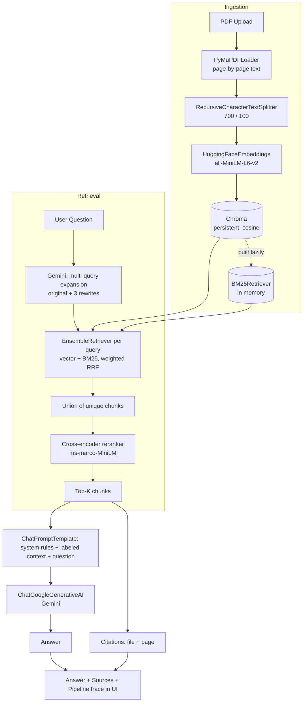

# College Notes AI — Chat with Your College Notes (RAG)

Upload your college PDF notes and ask questions about them in plain English.
Answers are generated **only** from your notes — never outside knowledge —
and every answer is cited with the exact PDF and page number it came from.

Built with **LangChain**, **ChromaDB**, local **sentence-transformers**
(embeddings + reranking) and **Google Gemini** for answer generation.
Documents and vector indexes stay on your machine; only the question,
the generated search rewrites, and the retrieved chunks are sent to Gemini.

## 1. What makes this more than a toy RAG

A naive RAG app embeds the question, grabs the 5 nearest chunks, and hopes.
That fails in predictable ways, and this project fixes each one:

| Failure | Fix |
|---|---|
| The student's wording doesn't match the textbook's wording | **Multi-query expansion** — Gemini rewrites the question 3 ways, so retrieval gets several shots at the notes' actual vocabulary |
| Exact terms (`RAID 5`, `TCP`, `O(log n)`) rank below vaguely-related prose, because embeddings under-weight literal tokens | **Hybrid search** — BM25 keyword search runs alongside dense vector search, covering each other's blind spots |
| The two retrievers produce incomparable scores (cosine `[0,1]` vs unbounded BM25), so results can't just be averaged | **Reciprocal Rank Fusion** — LangChain's `EnsembleRetriever` fuses *ranks* rather than scores, with weights |
| Fusion picks the shortlist but never reads the question against a chunk | **Cross-encoder reranking** — a precision pass over the merged candidates that scores each (question, chunk) pair directly |

## 2. Features

- Upload PDFs (lecture notes, textbooks, slides) — validated and indexed in
  the background with live status in the UI
  (`Queued → Indexing… → Ready`, or `Failed` with a reason).
- Ask questions in a chat interface; optionally scope a question to one
  specific document.
- Multi-stage retrieval: multi-query → hybrid (dense + BM25, RRF) → rerank.
- Answers are grounded strictly in retrieved chunks — if nothing relevant
  is found, the app says so instead of guessing.
- Every answer cites its sources: PDF filename + page number, taken from
  chunk metadata, never fabricated.
- **RAG pipeline explorer** — tick "Show RAG pipeline" to inspect, for any
  answer, the generated queries, retrieved chunks, reranking scores and the
  exact context sent to Gemini.
- Each stage is a flag at the top of `rag.py`, so you can measure what it buys.

## 3. Architecture



## 4. Project structure

```
backend/
    .env              GEMINI_API_KEY (and optional GEMINI_MODEL) — not committed
    requirements.txt
    app/
        ingest.py     PDF → pages → chunks → Chroma, plus the document store
        rag.py        the RAG engine: vector store, BM25, multi-query, RRF,
                      reranking, retrieve_with_trace(), grounded generation
        schemas.py    Pydantic request/response models
        api.py        HTTP routes (documents + chat)
        main.py       FastAPI app and CORS
    data/             created at runtime: uploaded PDFs + Chroma index
frontend/src/
    App.jsx           state, polling for indexing status, API calls
    components/       Sidebar, FileUpload, Chat, Message, Sources,
                      PipelineExplorer
```

## 5. The retrieval pipeline in detail

A question goes through `rag.retrieve_with_trace()`:

1. **Multi-query expansion** — a LangChain chain
   (`prompt | ChatGoogleGenerativeAI | LineListOutputParser`) produces
   `MULTI_QUERY_COUNT` alternative phrasings. The rewrites are a retrieval
   aid only; the *original* question is what gets answered and what the
   reranker scores against. If expansion fails, retrieval continues with the
   original query only and the error is shown in the pipeline explorer.
2. **Hybrid search, per query** — each query runs through an
   `EnsembleRetriever` that combines:
   - *Dense*: Chroma cosine nearest-neighbours, filtered by
     `RETRIEVAL_THRESHOLD`, because vector search always returns its `k`
     nearest neighbours even when none are actually relevant.
   - *Sparse*: `BM25Retriever` over the same chunks (never threshold-filtered
     — the point of the keyword leg is exact terms the embedding under-weights).

   The ensemble merges both rankings with weighted **Reciprocal Rank
   Fusion**: each list votes for a chunk with `weight / (60 + rank)`. Only
   positions matter, so cosine and BM25 scores never have to be made
   comparable.
3. **Merge** — results from all queries are combined and de-duplicated by
   chunk id.
4. **Cross-encoder reranking** — the merged candidates are scored by
   `ms-marco-MiniLM`, which reads the question and chunk *together* rather
   than comparing two independently-built vectors. Accurate but slow, which
   is why it only sees a shortlist. The top `TOP_K` survive.
5. **Generation** — the final chunks are labeled
   `[Source: X.pdf | Page N | Chunk: id]` and sent to Gemini with a system
   prompt that forbids outside knowledge. Citations are built from the chunks
   actually used.

## 6. Tech stack

**Backend:** Python, FastAPI, LangChain (`langchain-core`,
`langchain-community`, `langchain-classic`, `langchain-chroma`,
`langchain-huggingface`, `langchain-google-genai`,
`langchain-text-splitters`), PyMuPDF, Sentence-Transformers (bi-encoder +
cross-encoder), ChromaDB, `rank-bm25`, Pydantic.

**LLM:** Google Gemini (default `gemini-2.5-flash`) via the Gemini API.

**Frontend:** React, Vite, Axios, plain CSS.

## 7. Setup

### Gemini API key (required)

Create a free key in [Google AI Studio](https://aistudio.google.com/apikey),
then create `backend/.env`:

```env
GEMINI_API_KEY=your_key_here
# optional
GEMINI_MODEL=gemini-2.5-flash
```

### Backend

```bash
cd backend
python -m venv .venv
source .venv/bin/activate        # Windows: .venv\Scripts\activate
pip install -r requirements.txt
uvicorn app.main:app --reload --port 8000
```

API docs: http://localhost:8000/docs

The embedding and reranker models download automatically on first use
(~120 MB total).

### Frontend

```bash
cd frontend
npm install
npm run dev
```

App: http://localhost:5173

## 8. Configuration

| Setting | Where | Default | Notes |
|---|---|---|---|
| `GEMINI_API_KEY` | `backend/.env` | — | required |
| `GEMINI_MODEL` | `backend/.env` | `gemini-2.5-flash` | any Gemini chat model |
| `TOP_K` | `rag.py` | `5` | chunks sent to the LLM |
| `CANDIDATES` | `rag.py` | `20` | per-retriever candidates per query |
| `RETRIEVAL_THRESHOLD` | `rag.py` | `0.3` | min cosine similarity on the dense leg |
| `ENABLE_HYBRID` | `rag.py` | `True` | add the BM25 leg |
| `VECTOR_WEIGHT` / `BM25_WEIGHT` | `rag.py` | `0.7` / `0.3` | relative pull inside RRF |
| `ENABLE_MULTI_QUERY` / `MULTI_QUERY_COUNT` | `rag.py` | `True` / `3` | Gemini rewrites the question |
| `ENABLE_RERANKER` | `rag.py` | `True` | cross-encoder precision pass |
| `EMBEDDING_MODEL` / `RERANKER_MODEL` | `rag.py` | MiniLM models | any compatible Hugging Face model |
| chunk size / overlap | `ingest.py` | `700` / `100` | characters |

> Changing the embedding model or chunk settings requires deleting
> `backend/data/chroma` and re-uploading your PDFs.

**Speed vs quality:** multi-query costs one extra Gemini call per question
and reranking costs a model pass over the candidates. On a slow CPU, set
`ENABLE_MULTI_QUERY = False` first. Set both to `False` and you're back to
plain hybrid retrieval, which is a useful baseline to compare against.

## 9. API endpoints

| Method | Path | Description |
|---|---|---|
| GET | `/api/health` | Health check |
| GET | `/api/documents` | List uploaded documents (with status) |
| POST | `/api/documents/upload` | Upload a PDF; indexes in the background |
| DELETE | `/api/documents/{document_id}` | Delete a document and its vectors |
| POST | `/api/chat` | Ask a question; returns `{answer, sources, trace?}` |
| POST | `/api/chat/debug-retrieve` | Retrieval only, no LLM — see which chunks matched |

Set `include_trace: true` in the `/api/chat` request (the "Show RAG pipeline"
checkbox in the UI) to get the full retrieval trace. `debug-retrieve` is the
fastest way to tune the pipeline: change a weight, re-ask, and watch the
ranking move without waiting on generation.

## 10. Example questions

```
What is demand paging?
Explain the difference between TCP and UDP.
What is normalization?
What is the time complexity of B+ tree search?
Explain gradient descent.
```

## 11. Talking about this project in an interview

- **What problem does RAG solve?** LLMs can't know your private documents
  and can't cite sources from memory. RAG grounds generation in evidence
  retrieved at query time instead of retraining the model.
- **Why chunk?** One vector per input means a whole document's embedding
  averages many unrelated topics and matches nothing specific. Chunk size
  trades context completeness against topic purity.
- **Bi-encoder vs cross-encoder?** A bi-encoder embeds query and document
  independently, so document vectors are precomputed and search is cheap —
  good for recall over everything. A cross-encoder reads the pair jointly:
  more accurate, too slow to run over the corpus, so it reranks a
  shortlist. That two-stage funnel is recall first, precision second.
- **Why hybrid search?** Dense retrieval matches meaning but under-weights
  rare literal tokens; BM25 does the opposite. Queries containing both a
  concept and an exact term ("how does RAID 5 handle parity") need both.
- **Why RRF instead of averaging scores?** Cosine similarity and BM25 live
  on different, unbounded scales, so averaging them is meaningless without
  normalization that itself distorts results. RRF uses only rank position,
  which makes fusion scale-free.
- **Why multi-query?** One phrasing is one guess at how the source
  material words the idea. Several phrasings, merged, reduce the variance
  of that guess. The cost is one extra LLM call.
- **How do you prevent hallucination?** Nothing makes it impossible, but:
  threshold-filter weak chunks, instruct the model to answer only from
  context and to admit when it can't, and surface citations and the exact
  context so ungrounded claims are visible rather than hidden.
- **Why LangChain here?** It provides the vector store, BM25 and ensemble
  retrievers, prompt/LLM/parser chains and document loaders as standard
  components, so the project is mostly configuration of those parts with a
  small amount of orchestration code, instead of hand-written plumbing.

## 12. Possible extensions

- **Retrieval evaluation** — Hit@K / MRR over a small labeled question set.
- **Streaming responses** — token-by-token instead of waiting for the full
  answer.
- **Conversation history** — each question is currently independent, so
  "explain that more" doesn't work yet. Needs history-aware query rewriting.
- **OCR for scanned PDFs** — currently rejected with a clear error.
- **Per-course collections** instead of one collection filtered by
  `document_id`.
- **Persisted document status** — indexing status is held in memory and
  resets on restart; a small database would fix that.
- **Fully local mode** — swap `ChatGoogleGenerativeAI` for `ChatOllama`
  (one-line change) to keep everything on your machine.

## 13. Troubleshooting

| Symptom | Likely cause | Fix |
|---|---|---|
| 502 "GEMINI_API_KEY is missing" | `.env` not found or key not set | Create `backend/.env` and restart the backend |
| 502 "Gemini request failed…" | Invalid key, quota/rate limit, or wrong `GEMINI_MODEL` | Check the key and model name in AI Studio |
| Document stuck on "Failed: No extractable text" | Scanned PDF with no text layer | Run OCR on the PDF first |
| Every question is slow | Multi-query adds an LLM call; reranking adds a model pass | Set `ENABLE_MULTI_QUERY = False`, and `ENABLE_RERANKER = False` if still slow |
| First question after startup is slow | Embedding/reranker models load lazily | Expected; later questions are faster |
| Old documents behave oddly after an update | Index built with an older chunk/metadata format | Delete `backend/data/chroma` and re-upload |
| Exact terms still don't match | BM25 leg off or outweighed | Check `ENABLE_HYBRID`, raise `BM25_WEIGHT` |
